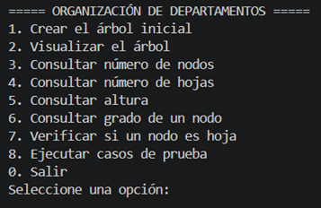
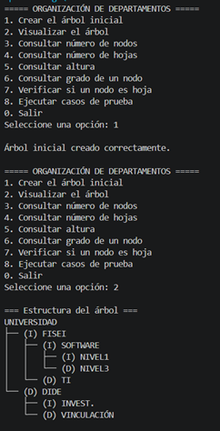
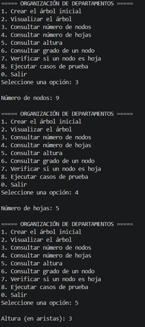
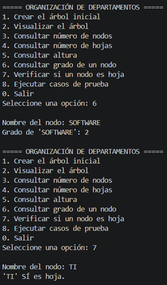
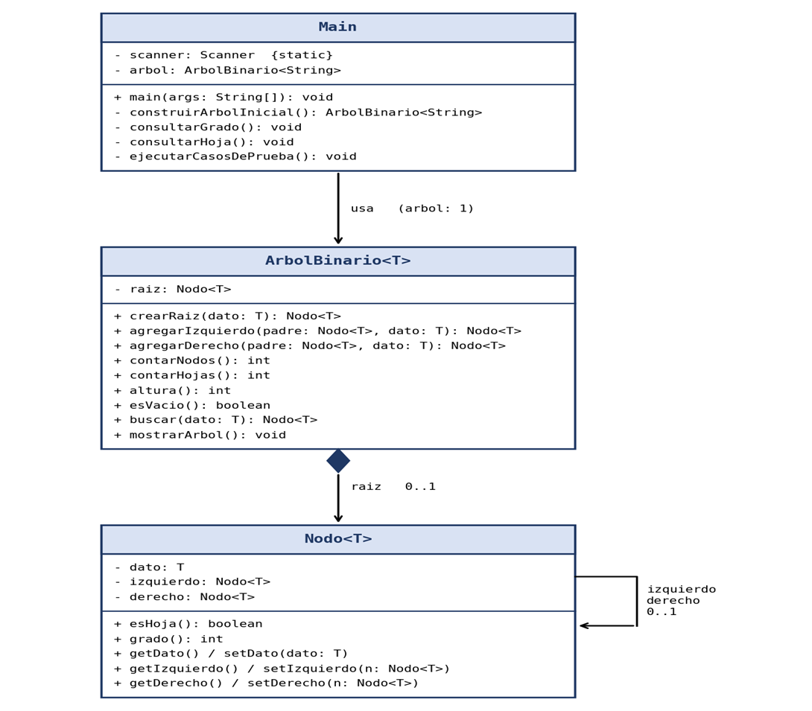

# Implementación de un árbol binario en Java

**Autor:** Joel Tisalema
**Asignatura:** Estructura de Datos
**Nivel:** Tercero – Ingeniería de Software
**Modalidad:** Individual
**Tipo:** Práctica de programación
**Herramientas:** Java, Visual Studio Code y GitHub
**Calificación:** 3 puntos

---

## 1. Objetivo

Implementar un árbol binario utilizando programación orientada a objetos en Java, aplicando operaciones de inserción, consulta y análisis de su estructura jerárquica mediante recursividad.

## 2. Descripción del proyecto

### Sistema de organización jerárquica de departamentos universitarios

El proyecto consiste en una aplicación Java que representa la organización de las dependencias académicas de una universidad mediante un árbol binario.

Cada nodo almacena el nombre de una dependencia y puede tener como máximo dos hijos: izquierdo y derecho. La aplicación permite construir, visualizar y analizar la estructura mediante un menú interactivo en consola.

## 3. Estructura inicial del árbol binario

```text
                 UNIVERSIDAD
                 /         \
              FISEI         DIDE
             /    \         /   \
       SOFTWARE    TI   INVEST.  VINCULACIÓN
        /    \
     NIVEL1  NIVEL3
```

### Características del árbol

| Propiedad          | Resultado     |
| ------------------ | ------------- |
| Nodo raíz          | UNIVERSIDAD   |
| Número de nodos    | 9             |
| Número de hojas    | 5             |
| Altura del árbol   | 3 aristas     |
| Grado máximo       | 2             |
| Tipo de estructura | Árbol binario |

**Nodos hoja:** NIVEL1, NIVEL3, TI, INVEST. y VINCULACIÓN.

**Nodos internos:** UNIVERSIDAD, FISEI, SOFTWARE y DIDE.

La altura se calcula contando las aristas del camino más largo desde la raíz hasta una hoja: UNIVERSIDAD → FISEI → SOFTWARE → NIVEL1.

## 4. Organización del proyecto

El código está organizado en tres paquetes:

```text
T6-ArbolBinario-TisalemaJoel/
│
├── src/
│   ├── modelo/
│   │   └── Nodo.java
│   │
│   ├── negocio/
│   │   └── ArbolBinario.java
│   │
│   └── app/
│       └── Main.java
│
├── evidencias/
│   ├── menu.png
│   ├── arbol-inicial.png
│   ├── arbol-vacio.png
│   ├── arbol-un-nodo.png
│   ├── insercion-invalida.png
│   └── consultas.png
│
└── README.md
```

### 4.1. Clase Nodo.java — Paquete modelo

Clase genérica `Nodo<T>` que representa cada elemento del árbol.

* `dato`: información almacenada en el nodo.
* `izquierdo`: referencia al hijo izquierdo.
* `derecho`: referencia al hijo derecho.
* `esHoja()`: indica si el nodo no tiene hijos.
* `grado()`: devuelve el número de hijos del nodo (0, 1 o 2).
* Getters y setters de sus atributos.

### 4.2. Clase ArbolBinario.java — Paquete negocio

Administra la estructura y las operaciones del árbol.

* `crearRaiz(dato)`: crea la raíz del árbol.
* `agregarIzquierdo(padre, dato)`: agrega un hijo izquierdo.
* `agregarDerecho(padre, dato)`: agrega un hijo derecho.
* `contarNodos()`: calcula el número total de nodos.
* `contarHojas()`: calcula el número de hojas.
* `altura()`: calcula la altura del árbol en aristas.
* `esVacio()`: verifica si el árbol está vacío.
* `mostrarArbol()`: presenta la estructura del árbol en consola.
* `buscar(dato)`: localiza un nodo por su nombre, usado por el menú para consultar grado y hojas.

El conteo de nodos, el conteo de hojas y la altura se implementan con **recursividad**. Las operaciones de inserción comprueban que la posición esté libre; si está ocupada, lanzan una `IllegalStateException` y la estructura original no se modifica.

### 4.3. Clase Main.java — Paquete app

Contiene el método `main()` y el menú interactivo, que usa `Scanner` para leer las opciones del usuario. También incluye la construcción del árbol inicial y la ejecución de los casos de prueba.

## 5. Funcionalidades del programa

```text
===== ORGANIZACIÓN DE DEPARTAMENTOS =====
1. Crear el árbol inicial
2. Visualizar el árbol
3. Consultar número de nodos
4. Consultar número de hojas
5. Consultar altura
6. Consultar grado de un nodo
7. Verificar si un nodo es hoja
8. Ejecutar casos de prueba
0. Salir
Seleccione una opción:
```

| Opción | Operación                  | Descripción                                                          |
| :----: | -------------------------- | -------------------------------------------------------------------- |
| 1      | Crear árbol inicial        | Construye la estructura universitaria de 9 nodos.                    |
| 2      | Visualizar árbol           | Dibuja la jerarquía en consola, con (I) izquierdo y (D) derecho.     |
| 3      | Consultar número de nodos  | Obtiene el total de nodos.                                           |
| 4      | Consultar número de hojas  | Obtiene el número de nodos sin hijos.                                |
| 5      | Consultar altura           | Camino más largo desde la raíz hasta una hoja, medido en aristas.    |
| 6      | Consultar grado de un nodo | Indica cuántos hijos tiene el nodo cuyo nombre se ingresa.           |
| 7      | Verificar si es hoja       | Indica si el nodo ingresado carece de hijos.                         |
| 8      | Ejecutar casos de prueba   | Ejecuta los cinco casos de prueba obligatorios.                      |
| 0      | Salir                      | Finaliza el programa.                                                |

Si se consulta un nodo antes de crear el árbol, o un nombre que no existe, el programa muestra un mensaje en lugar de fallar.

## 6. Instrucciones de instalación y ejecución

### 6.1. Requisitos previos

* Java JDK instalado.
* Visual Studio Code con la extensión *Extension Pack for Java*.
* Git, si se desea clonar el repositorio desde la terminal.

Para comprobar que Java está instalado:

```bash
java -version
javac -version
```

### 6.2. Clonar el repositorio

```bash
git clone https://github.com/Joel03032007/T6-ArbolBinario-TisalemaJoel
cd T6-ArbolBinario-TisalemaJoel
```

### 6.3. Compilar las clases

Desde la carpeta principal del proyecto:

```bash
javac -encoding UTF-8 -d bin src/modelo/Nodo.java src/negocio/ArbolBinario.java src/app/Main.java
```

Este comando compila las tres clases y guarda los archivos `.class` en la carpeta `bin`.

### 6.4. Ejecutar el programa

```bash
java -cp bin app.Main
```

Si las tildes se ven mal en la terminal, ejecutar con:

```bash
java -Dfile.encoding=UTF-8 -cp bin app.Main
```

También es posible abrir el proyecto en Visual Studio Code y ejecutar `Main.java` con el botón **Run**.

## 7. Casos de prueba

Los cinco casos obligatorios se ejecutan desde la **opción 8** del menú.

### 7.1. Prueba 1: árbol vacío

**Resultado obtenido:**

```text
[1] Árbol vacío
Nodos: 0 (esperado 0)
Altura: -1 (esperado -1)
¿Vacío?: true
```

Sin raíz no existen nodos ni hojas. La altura es `-1` porque se mide en aristas.

### 7.2. Prueba 2: árbol con un solo nodo

**Resultado obtenido:**

```text
[2] Árbol con un solo nodo
Hojas: 1 (esperado 1)
Altura: 0 (esperado 0)
```

La raíz es también una hoja porque no tiene hijos, y su altura es 0 porque no hay aristas que recorrer.

### 7.3. Prueba 3: árbol universitario inicial

**Resultado obtenido:**

```text
[3] Árbol inicial
Nodos: 9 (esperado 9)
Hojas: 5 (esperado 5)
Altura: 3 (esperado 3)
```

### 7.4. Prueba 4: inserción en una posición ocupada

**Procedimiento:** con el árbol inicial creado, se intenta agregar un nuevo hijo izquierdo a FISEI, cuya posición izquierda ya está ocupada por SOFTWARE.

**Resultado obtenido:**

```text
[4] Insertar en posición ocupada
Correcto, se rechazó la inserción: La posición izquierda de 'FISEI' ya está ocupada por 'SOFTWARE'.
```

La inserción es rechazada y el árbol conserva su estructura original.

### 7.5. Prueba 5: consulta del grado de los nodos

**Resultado obtenido en la opción 8:**

```text
[5] Grado de nodos
Grado de FISEI: 2 (esperado 2)
Grado de SOFTWARE: 2 (esperado 2)
```

Con la opción 6 del menú se pueden consultar otros nodos:

| Nodo        | Grado esperado |
| ----------- | -------------: |
| UNIVERSIDAD |              2 |
| FISEI       |              2 |
| SOFTWARE    |              2 |
| DIDE        |              2 |
| TI          |              0 |
| NIVEL1      |              0 |
| NIVEL3      |              0 |

## 8. Evidencias de ejecución

Las imágenes se encuentran en la carpeta `evidencias/` del repositorio.

### 8.1. Menú principal



### 8.2. Visualización del árbol inicial



### 8.3. Consulta de nodos, hojas y altura



### 8.4. Consulta del grado de un nodo y verificación de hojas



### 8.5. Casos de prueba


### 8.6. Diagrama de clases



## 9. Restricciones de implementación

* Árbol implementado con clases propias y programación orientada a objetos.
* Clase genérica `Nodo<T>`.
* Código organizado en los paquetes `modelo`, `negocio` y `app`.
* Conteo de nodos, conteo de hojas y altura implementados con recursividad.
* Interacción con el usuario mediante `Scanner`.
* Validación de posiciones de inserción para no sobrescribir hijos existentes.
* No se utilizan `TreeSet`, `TreeMap`, `PriorityQueue`, `NavigableSet` ni `NavigableMap`.

## 10. Preguntas de reflexión

### 10.1. ¿Por qué la altura de un árbol binario depende del camino más largo desde la raíz hasta una hoja?

La altura mide cuántas aristas hay que recorrer para llegar al nodo más profundo. Si el árbol tiene varias ramas, las más cortas no cambian ese valor: solo cuenta la más larga. En este proyecto, el camino UNIVERSIDAD → FISEI → SOFTWARE → NIVEL1 tiene 3 aristas, mientras que el camino por DIDE tiene solo 2, por lo que la altura es 3.

Esto se refleja en la recursividad implementada: la altura de un nodo es 1 más el máximo entre la altura de sus dos hijos, y un nodo nulo devuelve `-1`, de modo que un árbol con un solo nodo tiene altura 0.

### 10.2. ¿Qué diferencias existen entre almacenar información en una lista enlazada y en un árbol binario?

En una lista enlazada cada nodo apunta solo al siguiente, por lo que los datos quedan en una sola línea y para llegar a un elemento hay que recorrer los anteriores. En un árbol binario cada nodo puede tener dos hijos, así que los datos se organizan en niveles y se puede representar una relación jerárquica de padres e hijos, como la de las dependencias de la universidad, algo que una lista no expresa de forma natural.

Además, en un árbol equilibrado la cantidad de pasos para llegar a un dato crece con la altura y no con el total de elementos, lo que lo hace más eficiente para buscar. La contrapartida es que el árbol es más complejo de implementar y recorrer, ya que requiere recursividad o estructuras auxiliares.

### 10.3. ¿Cómo podría utilizarse un árbol binario en el proyecto integrador SmartETL para organizar o buscar registros?

Un proceso ETL maneja grandes cantidades de registros que se extraen, transforman y cargan. Un árbol binario de búsqueda podría indexar los registros por una clave (por ejemplo, un identificador o una fecha), de modo que buscar un registro o detectar duplicados durante la transformación no requiera revisar todos los datos uno por uno.

También podría organizar la información de forma jerárquica, por ejemplo fuente de datos, tabla y campo, como en este proyecto se organizan las dependencias universitarias. Para mantener un buen rendimiento cuando crece la cantidad de registros, el árbol debería mantenerse equilibrado.

## 11. Conclusiones

La implementación de un árbol binario permite comprender cómo funcionan las estructuras de datos jerárquicas y refuerza la programación orientada a objetos, el uso de referencias entre nodos, la recursividad y la organización modular del código en paquetes.

También permite analizar propiedades fundamentales del árbol, como el número de nodos, las hojas, el grado de cada nodo y la altura. Las pruebas confirmaron el comportamiento correcto ante un árbol vacío, un árbol con una sola raíz y un intento de inserción en una posición ocupada.

## 12. Tecnologías utilizadas

* **Java** y **Java JDK:** desarrollo, compilación y ejecución.
* **Visual Studio Code:** entorno de desarrollo.
* **Git** y **GitHub:** control de versiones y alojamiento del repositorio.
* **Markdown:** elaboración de este README.

## 13. Control de versiones

El repositorio incluye al menos tres commits significativos que muestran el desarrollo individual del proyecto, por ejemplo:

```text
Crear clase generica Nodo
Implementar operaciones recursivas del arbol
Agregar menu interactivo y documentacion README
```

**Enlace al repositorio:** https://github.com/TU_USUARIO/T6-ArbolBinario-TisalemaJoel

---

**Asignatura:** Estructura de Datos
**Carrera:** Ingeniería de Software
**Universidad:** Universidad Técnica de Ambato

**Proyecto académico individual — 2026**
